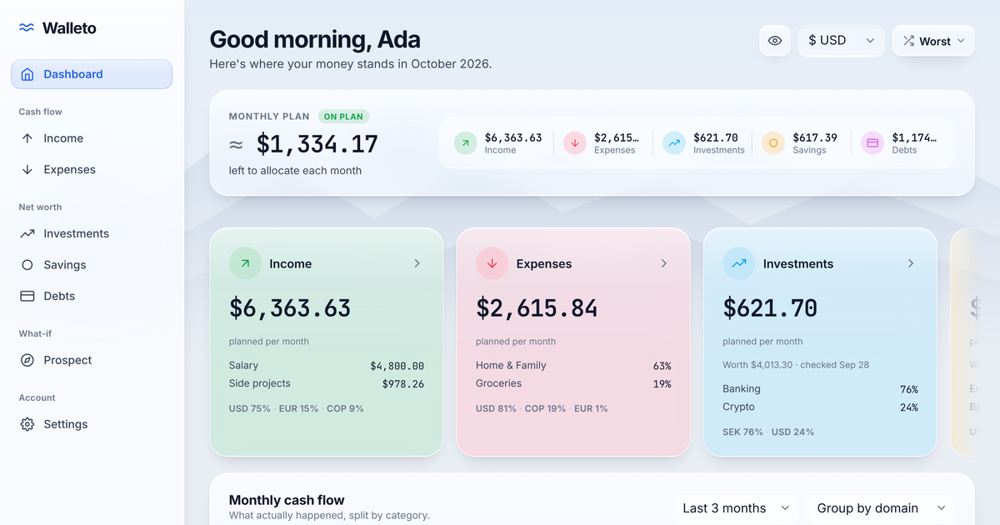
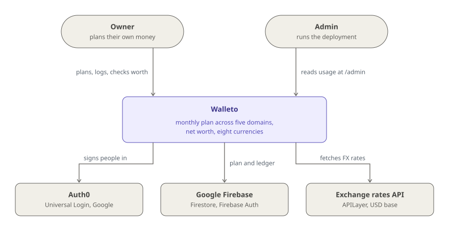

# Walleto

**A monthly money plan that tells you if you're on track and what you're worth today, in 8 currencies.**

[](https://github.com/glrodasz/walleto/actions/workflows/ci.yml)
[](LICENSE)


<br clear="left">

[**Live site**](https://walleto.guillermorodas.com) · [Storybook](https://walleto.guillermorodas.com/storybook) · [How it works](#how-it-works) · [Architecture](#architecture) · [Quick start](#quick-start) · [Deploy](#deploy)



## Why

Most money apps tell you what happened. They don't tell you whether you're on track. A list of
last month's spending says nothing about this one, it counts money you saved as money you spent,
and it breaks down when your salary is in dollars, your rent in pesos and a subscription in euros.

Walleto is a **planner**, not an expense tracker. It answers three questions: _what is my plan,
is this month on track, and where do I stand today?_ It works across five domains
(**income, expenses, investments, savings and debts**) instead of the usual two, with a plan
headline:

> **net = income − expenses − savings − investments − debt repayments**

Savings and investments are subtracted on purpose, not counted as spending: the headline is what's
left to allocate each month. And every amount keeps the currency it was entered in. Conversion
only happens when something is displayed, and any converted total is marked "≈".

It's for people who want a monthly plan they trust, often across several currencies. It's not for
people who want bank sync or automatic imports: there is no bank connection, and you enter your
plan yourself. Recurring payments then log themselves.

### Design principles

| Principle                               | In practice                                                                                                                                                                                                                            |
| --------------------------------------- | -------------------------------------------------------------------------------------------------------------------------------------------------------------------------------------------------------------------------------------- |
| **Plan first, ledger second**           | A recurring item is a rule ("Netflix, 15 USD, monthly, on the 14th"). Its occurrences are written to the ledger automatically, with six months of backfill (longer for quarterly and yearly items) when the start date is in the past. |
| **Store native, convert on read**       | Amounts are never converted at write time. One module (`helpers/aggregations.ts`) converts on read, and a card's real charge in another currency beats any market rate.                                                                |
| **Never make up a number**              | If exchange rates never loaded and currencies are mixed, the app shows a warning instead of a fake sum. Stale rates are flagged as stale.                                                                                              |
| **Errors are errors, not empty states** | A broken Firestore rule or a missing index shows its message (with the console link to create the index), never "no data".                                                                                                             |
| **Nothing is hard-deleted**             | Categories, tags, methods and accounts archive, recurring items deactivate, and transactions become "skipped", so old rows keep resolving.                                                                                             |
| **Nothing financial left behind**       | Firestore caches to IndexedDB for fast reloads, and "Log out" signs out of Firebase and clears that cache before ending the Auth0 session.                                                                                             |

## Quick start

Requires Node 24 (`.nvmrc`) and pnpm 9.

**See every screen in 5 minutes, no accounts needed.** Storybook mounts the real dashboard, domain
pages, settings and setup wizard over a mocked multi-currency demo profile. It never touches
Firestore or Auth0:

```bash
nvm use
pnpm install
pnpm storybook    # http://localhost:6006 → Templates/Dashboard
```

**Run the full app.** You need a Firebase project (Firestore) and an Auth0 application:

1. Copy `.env.local.example` to `.env.local` and fill it in.
2. **Firebase**: create a project, add a web app, and copy its credentials
   into the `NEXT_PUBLIC_*` variables. Then, under _Project settings → Service
   accounts_, generate a new private key and put its base64 into
   `FIREBASE_SERVICE_ACCOUNT_B64`.
3. **Auth0**: create a Regular Web Application (Next.js), copy its settings
   into the `AUTH0_*` variables, and add `http://localhost:3000/api/auth/callback`
   to _Allowed Callback URLs_ and `http://localhost:3000` to _Allowed Logout URLs_.
4. Point the Firebase CLI at your project (`npx firebase-tools use <project-id>`; `.firebaserc`
   names the maintainer's), then deploy the Firestore rules and indexes and start the app:

```bash
cp .env.local.example .env.local
pnpm firebase:deploy
pnpm dev          # http://localhost:3000
```

The database starts empty. After the first login, seed the catalogue and a demo profile
(see [Seed data](#seed-data)).

## How it works

### Five domains, one plan

| Domain      | What it holds                                            |
| ----------- | -------------------------------------------------------- |
| Income      | Salary, invoices, anything arriving                      |
| Expenses    | Subscriptions, rent, groceries, anything leaving         |
| Investments | Money moved into brokerage or retirement accounts        |
| Savings     | Money moved into savings pockets                         |
| Debts       | Repayments on credit cards, loans, mortgages, money owed |

The interface uses three nouns, always the same way: **Plan** (the recurring items, what should
happen every month), **Activity** (the ledger, what actually happened) and **Worth** (accounts and
pockets minus debts, where you stand today).

### From a rule to the numbers on screen

| Step             | How                                                                                                                                                                                                                                   |
| ---------------- | ------------------------------------------------------------------------------------------------------------------------------------------------------------------------------------------------------------------------------------- |
| Add to your plan | One form for everything. A recurring item is saved as a rule; a one-off is logged straight to the ledger.                                                                                                                             |
| Materialize      | An idempotent API route writes each past occurrence as a ledger row with a deterministic id (`{itemId}_{YYYY-MM-DD}`), so re-running it never duplicates or overwrites a row you edited or skipped.                                   |
| Read live        | Each section subscribes to Firestore with `onSnapshot` and paints from the IndexedDB cache first.                                                                                                                                     |
| Convert          | `useMoneyContext()` picks the display currency and the rates; the aggregations convert, sum and group.                                                                                                                                |
| Show             | The dashboard is the plan's monthly run-rate with an **On plan / Over-committed** verdict; each domain page shows the month against the plan, bars by category or currency, and the Plan, Activity, Categories, Tags and Worth views. |

### Money and currencies

USD, EUR, MXN, GBP, SEK, CHF, JPY and COP are supported (yen and pesos without decimals).
Exchange rates come from one API route with a 12-hour server cache and a daily mirror in Firestore
as a fallback; the browser keeps them for 24 hours. Variable expenses (groceries at €400–600) store
a band, and every total follows the Best / Average / Worst scenario you pick in the header.

### Worth

Investment accounts, savings pockets and debts carry an optional interest rate and **value checks**.
Between checks, a rate-bearing account is estimated by compounding each deposit; a check takes over
from its date and books the gain (or, on a debt, the interest) in that month. A debt is a negative
position with the same maths, so net worth is investments plus savings minus what you still owe.

Every screen, entity and number is described in detail in the
[product overview](docs/product-overview.md).

## Architecture

<picture>
  <source media="(prefers-color-scheme: dark)" srcset="docs/diagrams/context-dark.svg">
  
</picture>

Two kinds of people use Walleto: the **owner** of a plan, who signs in with Google through Auth0,
and an **admin** of the deployment, whose Auth0 id is in `ADMIN_USER_IDS` and who sees an
aggregate usage dashboard at `/admin` (counts and dates only, never amounts or item names).

Walleto depends on three outside systems. **Auth0** owns identity. **Google Firebase** holds every
user's data in Firestore, scoped by security rules to that user's id. An **exchange rates API**
(APILayer) supplies daily rates against USD. There is no bank integration and no scheduled job:
everything runs as Next.js pages and API routes on Vercel, plus live Firestore listeners in the
browser.

What runs where, how sign-in turns an Auth0 session into Firestore access, and how a plan item
becomes the numbers on screen are drawn in [**docs/ARCHITECTURE.md**](docs/ARCHITECTURE.md).

### Tech stack

**App:** Next.js 15 (Pages Router), React 18, strict TypeScript, styled-jsx, Recharts, Zod ·
**Data:** Firestore (client SDK with IndexedDB persistence, `firebase-admin` on the server) ·
**Auth:** Auth0 (`@auth0/nextjs-auth0`) with Firebase custom tokens · **i18n:** English, Spanish
and Portuguese catalogs · **Quality:** Jest and Testing Library (1,300+ tests), ESLint, Prettier, Husky,
Storybook 10 with the a11y addon · **Infra:** Vercel, GitHub Actions, pnpm

## Usage

### Scripts

```bash
pnpm dev          # http://localhost:3000
pnpm test         # jest with coverage
pnpm test:watch
pnpm lint
pnpm tsc --noEmit # type check
pnpm build        # production build
pnpm storybook    # component workbench at http://localhost:6006
pnpm build-storybook  # also hosted at /storybook on every Vercel deployment
```

### Seed data

The database starts empty. After the first login:

```bash
pnpm seed:global              # global services catalogue — run once
pnpm seed:user <userId>       # demo profile for one user (wipes their data first)
pnpm seed:user <userId> --dry-run   # preview, writes nothing
```

`<userId>` is the Auth0 `user.sub` of the logged-in user. Pass `--no-wipe` to
add on top of existing data. The demo history is derived from the recurring items with the same
materializer the app uses, so opening the dashboard duplicates nothing.

### Deploy

The app deploys to **Vercel**: pushes to `main` go to production, pull requests
get preview deployments. CI (type check, lint, test, build, Storybook build) runs on every push
to `main` and every pull request against it.

Set the same variables from `.env.local.example` in the Vercel project.
`AUTH0_BASE_URL` must be set for _Production_ only; leaving it unset for
_Preview_ lets each preview build its callback URL from the request host. Add
the preview hostnames to Auth0's _Allowed Callback URLs_ and _Allowed Logout
URLs_.

Firestore rules and indexes are deployed separately:

```bash
pnpm firebase:deploy
```

Deploying the indexes is **not optional**: the charts, period totals and recent
payments queries combine filters with a range or `orderBy`, and Firestore
refuses to run them without a matching composite index.

Each build paints its accent differently so it's never mistaken for production: production keeps
the palette's own, previews are red and local development is green.

### Project layout

```
pages/                 routes; page bodies live in features/*/components/*Page.tsx
pages/api/             API routes: Auth0 session, Zod validation, firebase-admin writes
features/<name>/       one folder per feature: dashboard, domains, onboarding, settings,
                       investments, prospect, landing, admin, create…
components/            shared UI by Atomic Design: atoms, molecules, organisms
hooks/                 data hooks (Firestore listeners) and shared state
helpers/               business logic: aggregations, fx, recurrence, materializer…
utils/                 generic utilities with no business knowledge
schemas/ types/        Zod schemas and domain types
messages/ i18n/        English, Spanish and Portuguese catalogs, locale resolution
firebase/ lib/         Firebase and Auth0 SDK setup
stories/               Storybook fixtures, mocks and page templates
scripts/firebase/      seed scripts
firestore.rules        per-user security rules; firestore.indexes.json for composite indexes
```

## Documentation

| Doc                                                       | What's in it                                                             |
| --------------------------------------------------------- | ------------------------------------------------------------------------ |
| [Architecture](docs/ARCHITECTURE.md)                      | Containers, sign-in, and how a plan item becomes the numbers on screen   |
| [Product overview](docs/product-overview.md)              | What the app is, the data model, and what every screen shows and means   |
| [AGENTS.md](AGENTS.md)                                    | Code conventions: where things go, styles, data rules, API routes, tests |
| [Storybook](https://walleto.guillermorodas.com/storybook) | Every component and screen over mocked demo data                         |

## Contributing

Issues and pull requests are welcome. Read [AGENTS.md](AGENTS.md) first: small single-purpose
files, every write through an API route, every visible string in the English, Spanish and Portuguese
catalogs, and a colocated story and test next to each component. Before pushing, run what CI runs:

```bash
pnpm tsc --noEmit && pnpm lint && pnpm test && pnpm build && pnpm build-storybook
```

## License

[Apache-2.0](LICENSE) © 2026 Guillermo Rodas.

<sub>Built by [Guillermo Rodas](https://github.com/glrodasz).</sub>
