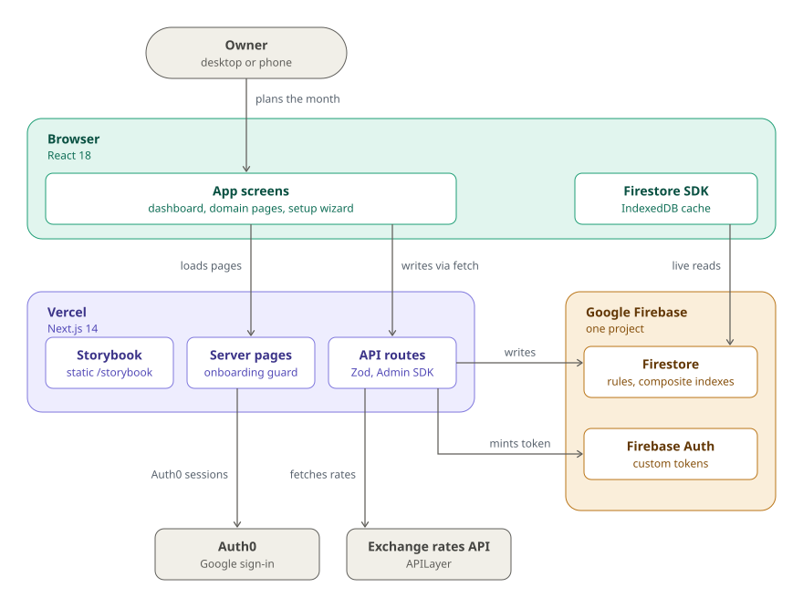
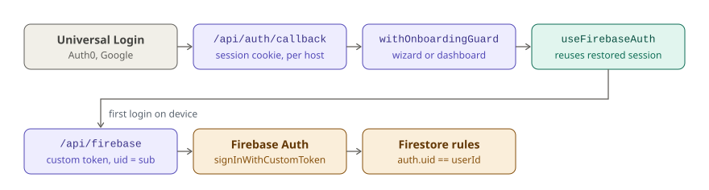
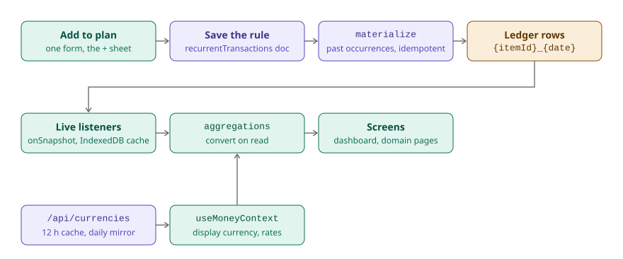

# Architecture

How Walleto is built, one level below the [system context in the README](../README.md#architecture):
what runs where, how an Auth0 sign-in becomes access to the user's own Firestore documents, and
how a plan item becomes the numbers on screen. Code conventions live in [AGENTS.md](../AGENTS.md);
what each screen shows lives in the [product overview](product-overview.md).

**Reading the diagrams:** teal is the browser, purple is Vercel (Next.js pages and API routes),
amber is Google Firebase, gray is people and outside services. Function, route and hook names are
set in monospace.

## Containers: what runs where

<picture>
  <source media="(prefers-color-scheme: dark)" srcset="diagrams/containers-dark.svg">
  
</picture>

Reads and writes take different paths on purpose. **Reads** go straight from the browser to
Firestore with `onSnapshot`, guarded by security rules that only match documents whose `userId`
is the signed-in user. **Writes** always go through an API route (`fetch`), which checks the Auth0
session, validates the body with Zod, verifies that every referenced category, method, account or
tag belongs to the user (403 otherwise) and writes with `firebase-admin`. The client never writes
to Firestore directly, even where the rules would allow it.

Because the screen only changes when the listener returns the server's copy, a few boolean toggles
(hide from dashboard, hide from chart, essential) are painted optimistically and dropped once a
matching snapshot arrives.

There are no background jobs. Past occurrences of recurring items are written when the dashboard
mounts (once per browser session) and right after creating something dated in the past.

Every Vercel deployment also serves the static Storybook at `/storybook`: the `vercel-build`
script builds it into `public/storybook/` before `next build`.

## Sign-in: from an Auth0 session to Firestore access

<picture>
  <source media="(prefers-color-scheme: dark)" srcset="diagrams/sign-in-dark.svg">
  
</picture>

Auth0 owns identity; Firestore rules authorize by Firebase uid. The bridge is a **Firebase custom
token whose uid is the Auth0 `sub`**, minted by `/api/firebase`. The same call creates the user
document and seeds default categories the first time someone signs in.

- The callback URL is derived from the request host, not fixed at build time, so the same build
  works on the custom domain, a branch alias or a deployment hash (Auth0's allow-list still decides
  which hosts are accepted).
- `withOnboardingGuard` runs on the dashboard and the domain pages, client-side navigations
  included. Once the user document says onboarding
  is complete, it caches that flag in the Auth0 session and stops reading Firestore.
- `useFirebaseAuth` waits for Firebase to restore its session from IndexedDB; a returning user on
  the same device skips `/api/firebase` entirely.
- "Log out" signs out of Firebase and clears the IndexedDB cache before ending the Auth0 session,
  so no financial data stays on a shared device.

## From a plan item to the numbers on screen

<picture>
  <source media="(prefers-color-scheme: dark)" srcset="diagrams/plan-to-numbers-dark.svg">
  
</picture>

A **recurring item** is a rule, not money that moved. The materialize route writes each past
occurrence into the ledger as a paid transaction with the deterministic id
`{itemId}_{YYYY-MM-DD}`. That makes it idempotent: running it again never duplicates a row, and
never overwrites one the owner edited or skipped. The backfill window is six months, 12 for
quarterly items and 24 for yearly ones. The seed script uses the same materializer, so seeded
history and app-written history share ids.

Amounts are stored in their own currency and converted only on read. `useMoneyContext()` is the
single place that picks the target currency (`displayCurrency`, else `mainCurrency`) and the rates;
`helpers/aggregations.ts` is the single place that converts, signs and sums rows. Rates come from
`/api/currencies`, which keeps a 12-hour in-memory cache, mirrors each day's rates to Firestore
and serves that mirror, marked stale, when the upstream API fails. The browser keeps rates for 24
hours. When no rates were ever loaded and currencies are mixed, screens show a warning instead of
a sum.

Queries that combine filters with a range or `orderBy` need the composite indexes in
`firestore.indexes.json`, which `pnpm firebase:deploy` deploys. Without them the listener fails,
and the error is shown as an error, never as an empty list.

## See also

- [README](../README.md): why Walleto exists, quick start, deploy and project layout.
- [Product overview](product-overview.md): the data model and what every screen shows.
- [AGENTS.md](../AGENTS.md): where code goes, styles, data rules, API routes and tests.
